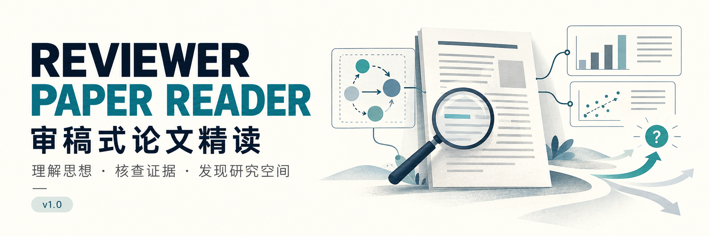

# 审稿式论文精读 · Reviewer Paper Reader

**v1.0 · Codex Skill · 中文优先 · Markdown 阅读记录**

从一篇论文中学会作者如何解决问题，判断新增贡献的依据，把值得追问的部分变成可验证的研究问题。

适合希望深入理解 AI、机器学习、多模态、智能体与机器人论文，并为后续研究寻找切入点的读者。它采用审稿式的问题意识，交付面向学习与研究决策的阅读说明。

已经安装后，可以直接这样开始：

```text
使用 $reviewer-paper-reader 阅读这篇论文：[PDF、论文链接或 Zotero 条目]。
讲清核心思想，判断相对最近工作的创新，核对主张与实验证据，
最后给出一个最值得先验证的研究问题。
```

<a id="contents"></a>
## 导航

[能帮你做什么](#capabilities) · [安装与快速开始](#quickstart) · [输入](#inputs) · [输出](#outputs) · [阅读方法](#method) · [场景提示词](#prompts) · [输出样例](#example) · [独立核查](#audit) · [续读与理解检验](#continuation) · [常见问题](#faq) · [目录与版本](#version)

<a id="capabilities"></a>
## 能帮你做什么

| 你关心的问题 | 阅读时重点做什么 | 你会拿到什么 |
|---|---|---|
| 这篇论文到底做了什么？ | 还原任务、已有做法、瓶颈与最小改变，走通一次运行 | 可以脱离模块名称复述的核心思想 |
| 思路为什么可能有效？ | 解释信息流、计算、决策、成立条件与简单替代 | 有前提、有作用路径的机制说明 |
| 创新究竟在哪里？ | 回查最接近的前作，分别判断技术差异、新颖性和贡献价值 | 有具体比较对象、范围与保留项的创新判断 |
| 实验真的支持结论吗？ | 按核心主张追踪对照、数据划分、归因、泛化和成本 | 主张与证据对应关系，以及证据允许的结论 |
| 我接下来能研究什么？ | 先辨认问题性质，再设计能区分解释的诊断 | 一个优先研究候选，以及继续、收缩或停止的依据 |

默认聚焦单篇论文。若只想问一个公式、图或实验，直接限定问题即可；不必每次完成整套精读。全文翻译、批量综述、正式审稿评分与训练复现需要另外明确任务范围。

<a id="quickstart"></a>
## 安装与快速开始

### 1. 准备运行环境

本仓库按 **Codex skill** 结构组织。Skill 本身是执行指令与参考规则，需要由支持技能的 Codex 环境读取。

- 本仓库没有额外的 Python 安装步骤，也没有要求填写的专用 API Key。
- PDF 阅读、联网检索、代码读取和 Zotero 访问使用宿主已有的工具及权限。
- Zotero 不是必装依赖；使用 Zotero 条目作为输入时，需要已配置可用的 Zotero 插件或连接工具。
- 本文安装示例使用 `~/.codex/skills/`。若设置了 `CODEX_HOME`，将技能放到该目录下的 `skills/`；其他配置以当前客户端实际识别的技能目录为准。

### 2. 安装技能目录

下载本仓库 ZIP 并解压，或克隆仓库。在包含本 README 的仓库根目录中，将整个 `reviewer-paper-reader/` 文件夹复制到 Codex 技能目录。

macOS / Linux，使用默认目录时：

```bash
mkdir -p ~/.codex/skills

if [ -e ~/.codex/skills/reviewer-paper-reader ]; then
  echo '目标技能已存在，请先备份并决定是否更新。'
else
  cp -R reviewer-paper-reader ~/.codex/skills/
fi
```

安装后应存在：

```text
~/.codex/skills/reviewer-paper-reader/SKILL.md
```

请复制整个技能文件夹，包括 `agents/` 和 `references/`。README、封面和 `docs/` 用于仓库展示，可以保留在仓库中。

### 3. 发出第一次阅读请求

在 Codex 对话中明确调用：

```text
使用 $reviewer-paper-reader 阅读我上传的 paper.pdf，按标准精读输出。
```

也可以用公开论文链接：

```text
使用 $reviewer-paper-reader 阅读这篇论文：[论文链接]。
我的方向是多模态智能体，请优先解释方法机制与实验归因。
```

将方括号里的内容换成自己的论文或需求。若当前会话尚未识别技能，可重新打开对话，再检查技能目录与名称。

<a id="inputs"></a>
## 输入：最少只需一篇可定位的论文

### 必需输入

下面任选一种：

| 输入方式 | 例子 | 需要注意 |
|---|---|---|
| 上传 PDF | `阅读我刚上传的 paper.pdf` | 扫描件、损坏公式和图表可能需要额外查看 |
| 本地文件 | `阅读当前项目 papers/paper.pdf` | 文件须在当前环境可访问 |
| 公开链接 | 论文主页、出版社页面、arXiv 链接 | 是否能取得全文取决于实际访问条件 |
| 标识符 | DOI、arXiv 编号 | 会核对论文身份与可读版本 |
| Zotero | 题名、条目或可定位的信息 | 先辨认条目与附件；重名时需作者或标识符辅助 |
| 摘要或节选 | `以下只有摘要，请先做初步解读` | 结论限定在提供的材料内，全文相关判断保留待核验 |

### 可选输入

你可以补充以下信息，也可以一句都不补充：

| 信息 | 对阅读的影响 |
|---|---|
| 阅读目标 | 决定是速读、机制讲解、创新比较、研究探索还是核查 |
| 知识背景 | 调整术语、数学展开与例子的难度 |
| 个人研究方向 | 解释论文与自己方向的技术连接和新增约束 |
| 指定比较论文 | 集中核对最关心的差异与前例 |
| 时间或篇幅预算 | 控制本轮展开范围，并标出重要未覆盖项 |
| 输出位置与格式 | 指定只在对话回答，或保存到某个目录 |

未说明时，默认中文标准精读：先给核心解释，再提供详细依据，并聚焦一个优先研究问题。只有歧义会改变论文身份或主要判断时，才需要进一步澄清。

<a id="outputs"></a>
## 输出：先读懂主线，再按需检查细节

### 默认交付

| 产物 | 主要内容 | 何时生成 |
|---|---|---|
| 对话主阅读页 | 任务与瓶颈、最小思想、新旧对照、关键效果、贡献边界、下一步 | 标准精读默认先给出；通常以约 600–1000 中文字为起点 |
| 详细 Markdown | 机制、必要图或公式、近邻比较、主张与证据、研究候选和来源定位 | 标准精读默认保存；服从用户指定的格式与路径 |
| 核查记录 | 检查对象、证据、修正、未知，以及实际完成的核查层级 | 按实际工作量并入主记录，或另存文件 |
| CSV、脚本、图像等 | 有必要的数值复算或辅助说明 | 只有实际做了且对判断有价值时生成 |

主阅读页服务于理解，详细记录服务于回查。报告长短按论文复杂度和本轮目标调整；短问题直接回答。

### 详细记录会覆盖哪些内容

1. **论文身份与范围：**题名、作者、版本、来源，以及本轮实际读到哪里。
2. **核心思想与机制：**任务、基线、瓶颈、最小改变、一次运行、关键规则和成立条件。
3. **创新与贡献：**最接近工作、具体差异、查证深度、新颖性与价值的分别判断。
4. **主张与证据：**实验或证明支持什么，哪些解释仍未区分，成本与泛化口径是什么。
5. **研究候选：**问题从哪里来、为什么值得问、先做什么诊断、什么结果会改变决定。
6. **来源与未知：**关键定位、未读、未取得、原文未报告、已有反证及下一阅读位置。

这些是应覆盖的判断内容，不要求生成六份独立报告，也不把每个章节再摘要一遍。

### 文件保存位置

优先遵循你指定的目录和当前项目约定。没有约定时，标准精读使用：

```text
output/paper-reading/<论文短名>/
├── 阅读记录_v01.md
└── 来源核查_v01.md       # 有必要单独保存时才生成
```

续读按要求更新或递增版本，保留重要历史稿。你也可以说“只在对话中输出，不保存文件”。没有可写目录时，会说明保存未执行。

<a id="method"></a>
## 阅读方法：从作者论证走向自己的研究判断

### 阅读顺序如何安排

阅读围绕会改变判断的问题展开。下表给出默认决策路径，实际会根据论文与新证据回跳，并补查全文和附录。

| 阶段 | 优先看什么 | 本阶段要解决什么 |
|---|---|---|
| ① 确定来源 | 题名、版本、摘要、引言、结论与材料可用性 | 作者在什么条件下承诺解决什么问题？ |
| ② 建立早期比较 | 相关工作中最可能改变创新定位的直接前作 | 已有方法究竟做到哪一步？ |
| ③ 走通思想 | 方法主图、关键规则或公式、实例、必要附录 | 最小改变是什么，它怎样产生作用？ |
| ④ 追查证据 | 主结果、强基线、关键消融、协议、表注、失败案例 | 每项核心主张实际得到了多强的支持？ |
| ⑤ 判断增量 | 前作原文、必要代码与两条时间线 | 技术差异、新颖性和贡献价值各自如何？ |
| ⑥ 形成研究决策 | 稳定失败、竞争解释、条件边界与当前直接解法 | 下一步应补读、做诊断、继续开发还是停止？ |

优先级不等于只看摘要和结论。影响判断的假设、实验划分、图表、附录和实现需要深入；用户要求逐段阅读时，按该覆盖要求执行。

### 核心思想怎样讲清楚

一条连贯解释应回答：

> 任务是什么 → 原来怎样做 → 哪一步在什么条件下失败 → 作者最小改变了什么 → 改变如何传到结果 → 依赖什么条件 → 简单替代方案能否解释收益。

随后用三个动作检查说明是否到位：

- **新旧对照：**把新增设计拿走，系统会恢复成什么做法？
- **一次运行：**让一个具体输入走过关键步骤，交代每一步能看到什么信息。
- **条件变化：**改变一项必要条件，预测方法会怎样变化，并标出尚未验证的预测。

公式只展开影响理解的部分：变量含义、计算时点、优化对象与行为意义。理论工作关注假设、定理、关键证明连接与反例；资源、系统、综述等论文使用适合其贡献的证据。

### 创新性怎样判断

| 判断 | 要问的问题 | 不足以单独证明它的材料 |
|---|---|---|
| 技术差异 | 相对哪个具体方法，改变了机制、目标、权限还是资源条件？ | 模块换名或框图不同 |
| 文献新颖性 | 这个思想、差异或组合是否已经有先例？ | 作者自述“首次”，或检索没有结果 |
| 贡献价值 | 增加了什么知识、能力、资源或成本优势，证据有多强？ | 名称、发表场所或最高分 |

近邻比较会追踪任务、可用信息、可改对象、提案与评价关系、更新规则、选择信号和实际成本。作者引用的工作、真正最接近的方法、实验里使用的基线，也可能是不同对象。

同时保留两条时间线：**评价原论文，依据其公开时点已有的知识；今天寻找选题，检查当前解法和后续工作。** 后来的工作不会被倒用来否定早期论文当时的创新。

### 实验证据怎样核查

以核心主张为单位，记录“主张 → 原文位置 → 对照与观察单位 → 结果 → 替代解释 → 支持范围”。根据论文需要，重点检查：

- **效果：**基线是否相关且足够强，提升和退化分别出现在哪里，稳定性如何。
- **归因：**完整系统有效与某组件有效分别有什么证据；消融是否同时改变了预算、数据或训练条件。
- **泛化：**未见的是题目、原始视频或文档、任务家族、模型还是分布。
- **成本：**构造、训练、搜索选择与部署如何计算；相同预算上限是否对应相近实际消耗。
- **反馈与数据：**标签、评分、排名、接受或拒绝、早停与版本选择，分别影响了哪个阶段。

核查也会区分“公布汇总值的算术复算”“原始预测重算”“静态代码检查”和“实际运行复现”。代码中的一条路径不能直接证明历史实验执行了它；没有显著差异也不等于已经证明等效。

### 怎样挖掘可验证的研究空间

首先辨认问题性质：

| 目前的疑问 | 优先动作 |
|---|---|
| 自己没读到或尚未理解 | 补读与解释 |
| 本文某项证据缺失 | 来源复核，判断是否影响主要结论 |
| 推测可能存在一种失败 | 先观测或诊断，确认现象是否稳定存在 |
| 明确条件下已有方法仍有剩余困难 | 查当前直接解法，设计能区分解释的实验 |

保留的研究候选至少说明：

1. **事实锚点与价值：**来源在哪里，哪些已观察到，哪些仍是假设，为什么值得解决。
2. **最近解法：**查过哪些直接前例，读到摘要、全文还是实现，候选的剩余差异是什么。
3. **中心假设与竞争解释：**为什么可能失败，还有什么更简单的解释。
4. **最小诊断：**改变什么、保持什么、真值与测量怎样定义、预算是否可比。
5. **后续机制检验：**诊断留下实质问题后，才比较新机制、简单方案与真正近邻。
6. **决策条件：**什么结果支持继续，什么结果要求收缩或停止，什么结果仍属证据不足。

默认集中展开一个优先问题。研究诊断可以从小规模排错开始，但正式样本量与重复次数需要依据效应、变异、精度和资源确定。没有可靠候选时，会说明原因，不为了完整性凑出方向。

<a id="prompts"></a>
## 按场景复制提示词

以下都是对话请求模板，不是命令行参数。保留 `$reviewer-paper-reader`，将方括号内容换成自己的信息即可。

### A. 第一次标准精读

```text
使用 $reviewer-paper-reader 阅读：[论文链接或文件]。
我的背景是[背景]，研究方向是[方向]。
先讲清核心思想，再判断创新和证据，最后给出一个优先研究问题。
详细记录保存到[目录]。
```

### B. 时间有限，先决定值不值得深读

```text
使用 $reviewer-paper-reader 速读：[论文]。
给我一版约10分钟可读完的说明：问题、最小思想、关键效果、主要限制、
与我研究方向的关系，以及接下来最值得看的图、表或段落。
请标明本轮重要的未覆盖材料。
```

### C. 只讲核心思想，避免术语堆叠

```text
使用 $reviewer-paper-reader 解释这篇论文的[方法或机制]。
先用最小新旧对照说明改变，再用一个输入走通全过程，
讲清各阶段的信息、计算和决策，并预测一个成立条件改变后的后果。
自己构造的例子请标为教学示例。
```

### D. 判断是否只是组合或改名

```text
使用 $reviewer-paper-reader 比较[论文A]与[论文B]，必要时查直接近邻。
分别判断技术差异、文献新颖性与贡献价值。
重点比较任务、信息权限、可改对象、优化反馈和实际成本。
请给出关键来源与阅读深度，保留尚未核验的差异。
```

### E. 检查实验是否支撑作者的主张

```text
使用 $reviewer-paper-reader 核查：[论文]。
围绕其核心主张建立证据对应关系，重点看[消融、泛化或成本]。
区分整体提升与组件归因，检查对照、划分、反馈和预算口径。
请把宽泛结论收缩到现有证据真正支持的范围。
```

### F. 为自己的方向寻找研究切入点

```text
使用 $reviewer-paper-reader 从[论文]寻找与[个人研究方向]相关的研究空间。
先区分个人未知、本文证据缺口、待验证现象与潜在领域问题。
查当前直接解法，只保留一个值得优先验证的候选。
给出竞争解释、最小诊断和继续/收缩/停止的条件；没有合适候选就说明原因。
```

### G. 从 Zotero 阅读

```text
使用 $reviewer-paper-reader 阅读 Zotero 中的“[完整题名]”，作者为[作者]。
先核对条目与附件版本，再按标准精读输出。
本轮读取条目与附件，不需要写回批注或导入新条目。
```

### H. 请求独立核查

```text
使用 $reviewer-paper-reader 阅读[论文]，并做独立核查。
请让独立上下文先只读原始材料形成来源底稿，再对照冻结的阅读稿。
重点核查机制、创新定位、实验口径和研究诊断是否成立。
交付核查结论、修订后的阅读记录和未完成项。
如果无法执行独立核查，请明确说明本轮实际完成的复核范围。
```

### I. 互动学习，而非一次读完整份报告

```text
使用 $reviewer-paper-reader 带我理解[论文或机制]。
一次聚焦一个理解障碍，等我回答后再判断问题并补讲。
先让我不用模块名解释关键改变，再用新情境检验理解。
```

### J. 在原记录上继续

```text
使用 $reviewer-paper-reader 继续[已有阅读记录]。
这次只处理[具体疑问]，沿用已核实的信息，检查相关结论是否需要修订。
若涉及今天的创新空间，请重新核查当前直接近邻。
```

<a id="example"></a>
## 输出样例：从“方法介绍”推进到“可验证问题”

> 以下为**虚构教学示例**，用来展示输出方式。它不是某篇论文的实测结论，也不证明这个研究方向存在创新。

假设一篇长视频问答论文提出“先粗看全局，再按问题定位局部片段”的方法。

### 核心思想会这样讲

**任务与瓶颈：**输入是一段视频和一个问题，模型能读取的画面有限。均匀采样可以覆盖全局，但短暂事件可能落在采样间隔中。

**最小改变：**先用粗略观测提出可能相关的时间区间，再把部分观测预算用于这些区间。变化发生在“下一步看哪里”的决策上。

**一次运行：**问题询问某人何时放下杯子。粗看阶段发现几个可能发生该动作的片段，局部阶段补看这些区间，再依据取得的证据回答。这个过程能否有效，依赖粗看是否保留了定位线索。

**条件变化：**如果短暂事件在粗看中完全不可见，局部检索可能没有可靠的起点。论文是否处理了这种情况，需要回查方法与失败案例。

### 创新与证据会分别判断

| 项目 | 示例判断 |
|---|---|
| 技术差异 | 需要确认新增的是选帧规则、反馈方式，还是已有策略的配置变化 |
| 新颖性 | 需要回查同机制前作；“粗到细”这个描述本身不足以确定独有差异 |
| 效果证据 | 若只报告系统总分提高，可以支持其在该设置下有效 |
| 归因边界 | 若同时增加了原始观测或调用次数，暂不能把收益全部归于定位策略 |

### 研究候选会先要求一个诊断

**待验证问题：**关键失败主要来自“没有取得足够证据”，还是“已有证据未被正确利用”？

**最小诊断：**在预定诊断集上，分别标注完整视频的任务真值与当前观测是否包含足以判断的证据。先固定同一份输入比较证据利用情况；再用匹配的观测选择对照检查覆盖问题，并记录新增信息、调用和实际成本。这样可以减少把“看得更多”误判为“推理更好”的风险。

**下一步决定：**若可靠诊断显示缺少证据占主导，再检验改进观测选择的机制；若证据充分时仍稳定失败，则转向证据利用问题。若标注或样本不足以区分两种解释，先改善测量。实际立项前仍需查新和判断问题价值。

<a id="audit"></a>
## 独立核查：什么时候做，做到什么程度

标准阅读会回查关键来源。**独立核查需要你明确提出，并且环境中有可用、授权的独立上下文。** 同一上下文重复阅读，不能记为独立盲核。

执行时分两阶段：

1. **来源先行：**核查者先读最少必要原始材料，记录机制、协议、数字和未知；此时不接收主阅读稿或预设结论。
2. **稿件对照：**来源底稿形成后，冻结阅读稿并记录版本身份；核查者对照稿件，优先检查会改变理解、创新判断或研究设计的问题。

成立的修正落实到核查后稿，并保留原稿、核查意见及修订对应。结论可以是“未发现重大错误”或“材料不足”；不会为了显得严格而强行提出问题。独立核查仍不等于原始实验复现。

当无法执行独立核查时，会写明“未执行独立核查”，并交代实际完成的来源复核、算术复算或静态检查。

<a id="continuation"></a>
## 续读、理解检验与反馈

### 如何检验自己是否读懂

可以让技能围绕论文检查四件事：

- 不借模块名，复述原有瓶颈与关键改变。
- 让一个新样本走通方法，说明当时能用哪些信息。
- 改变一个成立条件，预测行为如何变化。
- 提出一个简单替代方案，以及能区分它和作者解释的实验。

互动模式会等待你的真实回答，再针对障碍补讲。未作答的自检题标为待检验；报告完整、助手能给出答案或来源核查通过，都不能证明读者已经掌握。

### 如何继续前一次阅读

提供已有记录或保持同一对话，说明本轮要解决的问题。续读先查已读范围、修正过的判断与未解问题，再补相关材料。涉及当前研究空间时，会重新查新，旧笔记不能代替当前资料。

### 如何反馈以改进下一版本

建议按以下格式记录：

```text
论文与版本：
我的请求：
实际输出的问题：
原文证据或具体难点：
我希望它改成怎样：
```

具体失误比“再深入一点”更容易转化为有效修订。使用过程中的论文事实保存在阅读记录中，通用技能的修改另行请求并保留版本。

<a id="faq"></a>
## 常见问题

### 必须先提供研究方向或回答一组问题吗？

不需要。一篇可定位的论文即可开始。研究方向有助于判断个人关联，但不会被当成启动条件。

### 可以只读某个图、公式或实验吗？

可以。说明本轮范围即可，会补查必要上下文，不自动重做整篇。速读也会明确重要未覆盖项。

### 只有摘要，能判断创新和实验可靠吗？

可以先解释任务与初步思想，但不能据此完成依赖全文的机制、协议或贡献判断。输出会标注哪些需要全文继续核实。

### Zotero 不可用怎么办？

可改用附件 PDF、公开链接或标识符继续。能否直接读取 Zotero，取决于当前宿主是否配置了可用工具；本仓库不自带 Zotero 服务。

### 它会给论文录用概率或保证找到新选题吗？

不会。默认不做正式评分，不编造录用概率、预期提升或选题成功率。可以得到候选和诊断方案，也可以得到“目前不值得推进”或“证据不足”的结论。

### 报告里哪些是事实，哪些是建议？

会区分作者主张、原始证据、本轮推断、教学示例与研究建议，并保留关键来源定位。没有取得全文、数据或代码时，会说明相应判断的限制。

### 会自动训练模型、修改 Zotero 或把结果发出去吗？

默认阅读包含材料获取、只读查证、必要算术复核和笔记保存。训练、付费实验、Zotero 导入或批注写回、发布等，依据用户实际请求执行。

### 是否已验证能提升阅读效率？

v1.0 整理了两篇开发试读及其核查后的方法，尚未完成流程对照、留出论文验证或真实读者测评。当前可以说明工作方式和实际产物，不能声称已经证明节时或提升学习效果。

### 能否直接安装到其他 AI 工具？

本包按 Codex 的技能结构提供。其他宿主需要检查发现机制、元数据、工具与调用方式；本仓库没有验证跨宿主直接兼容。

<a id="version"></a>
## 目录与版本

### 仓库结构

```text
.
├── README.md                              # 人类使用说明
├── assets/
│   └── reviewer-paper-reader-cover.png    # README 顶部配图
├── docs/
│   └── cover-prompt.md                    # imagegen 最终提示词与生成记录
└── reviewer-paper-reader/                 # 安装时复制这个文件夹
    ├── SKILL.md                           # 模型读取的主流程
    ├── agents/
    │   └── openai.yaml                    # Codex 展示信息与默认提示词
    └── references/
        ├── mechanism-and-evidence.md      # 核心思想、机制与证据
        ├── novelty-and-research.md        # 创新比较与研究诊断
        └── delivery-and-audit.md          # 分层交付、独立核查与学习检验
```

执行规则见 [SKILL.md](reviewer-paper-reader/SKILL.md)。配图使用内置 imagegen 生成，最终提示词见 [封面生成记录](docs/cover-prompt.md)。封面中的图表为编辑插画。

### v1.0 · 2026-10-28

- 核心思想采用最小新旧对照、一次运行与条件变化解释。
- 技术差异、文献新颖性和贡献价值分别判断。
- 实验核查按主张组织，追踪信息、反馈、数据划分与成本。
- 研究探索先诊断，后检验新机制，保留继续、收缩或停止的决策。
- 支持分层交付、显式请求的独立核查、互动学习和续读。

开发阶段使用过《Self-Harness: Harnesses That Improve Themselves》和《VideoHarness-RSI: Recursive Harness Self-Improvement for Long-Video Understanding with Frozen Vision-Language Models》两篇论文进行试读与核查。这些经历用于整理方法，不代表封装后的技能已经通过独立效果评估。

### GitHub 页面呈现参考

本 README 的页面组织参考了下列公开项目的使用说明：

- [sodalone/paper-reading-skill](https://github.com/sodalone/paper-reading-skill)：封面、适用场景、输出说明与人类文档/执行规则的区分。
- [chenbingxiayu/PaperReaderSkill](https://github.com/chenbingxiayu/PaperReaderSkill)：快速开始、阅读方法与分场景使用说明。

参考范围为文档呈现方式；本仓库的能力、依赖、调用与输出均以自身 v1.0 文件为准，未引入上述项目的脚本或图片。
